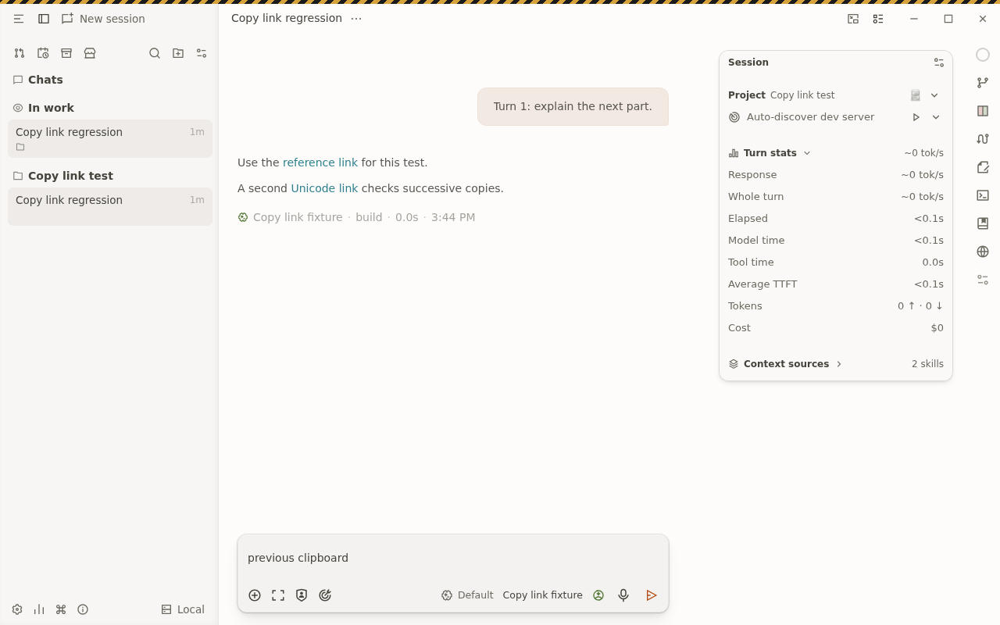
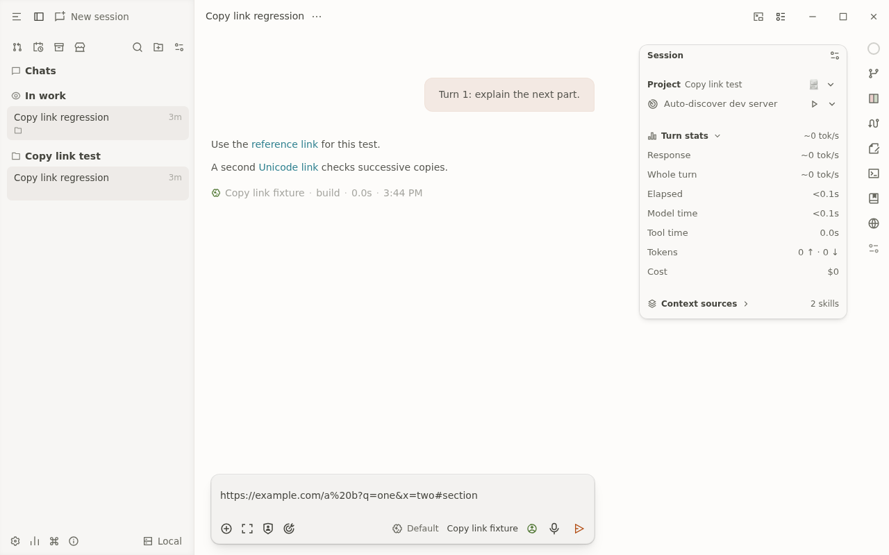

# Desktop Copy link visual evidence

Evidence for OpenChamber commit `164f012368668c6c1a92d1bcb046c2a065b6ea51`.

- **Before:** the original handler at `6491f51dbcf05d1e3f7f823049f5f097c96c234b` leaves `previous clipboard` after Copy link and paste.
- **After:** the fixed Linux AppImage copies and pastes the exact destination URL, including its query string and fragment.

The recordings exercise an actual assistant answer generated by a container-local synthetic provider, native context-menu selection, an independent `xclip` read and composer paste. Testing used Linux x64, Electron 44.9.0 and an isolated Xvfb display and clipboard. The before recording uses bundled development mode; the after recording uses the newly built AppImage with extract-and-run.

All content is synthetic. The running host application, its configuration and its clipboard were not used. Source edits after recording affected only comments and documentation.

## Recordings

- [Before](copy-link-before.mp4)
- [After](copy-link-packaged.mp4)

## Screenshots

### Before

### After

